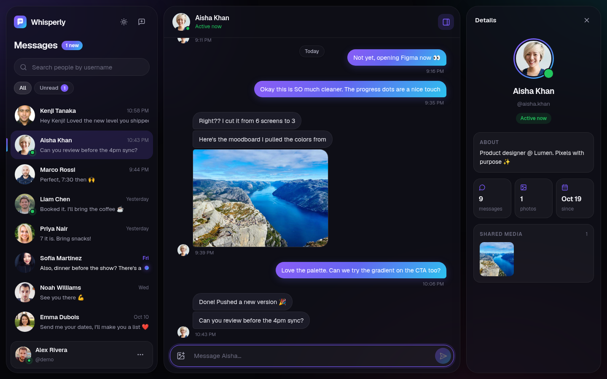
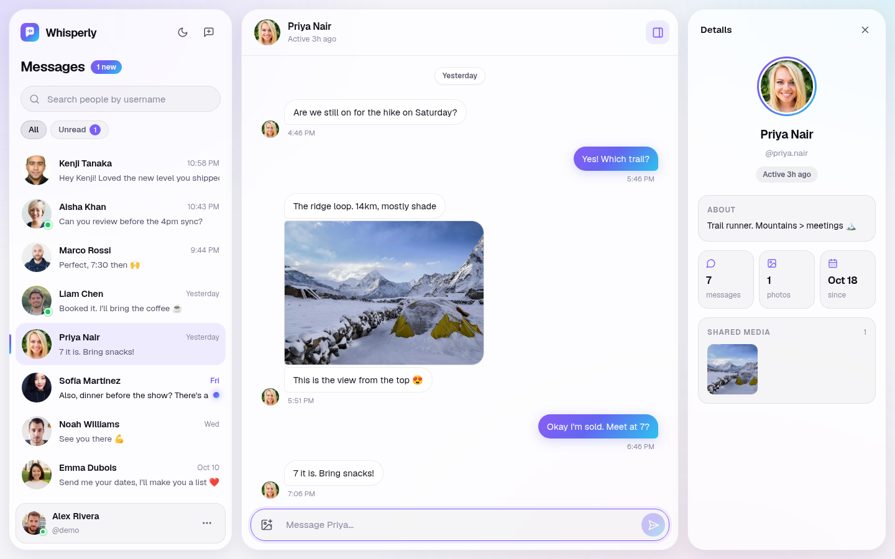
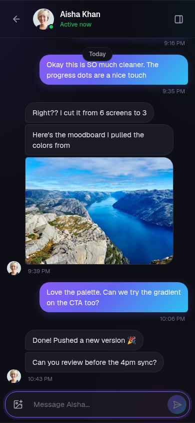

# Whisperly 2.0

A real-time one-to-one messenger built with **React**, **Vite** and **Firebase**. Sign up, set up a profile, find people by username and chat instantly, with photos, presence, unread tracking and a polished dark/light interface.



<p align="center">
  
  &nbsp;
  
</p>

## What's new in 2.0

- **Complete redesign**: glass panels on an aurora background, Geist typography, gradient accents and a design-token system (`src/index.css`)
- **Dark and light themes** that follow your system, with a one-click toggle (remembered per browser)
- **Smarter chat list**: live prefix search by username, All/Unread filters, unread count, relative timestamps and presence dots
- **Better conversations**: bubbles grouped by sender and time, day separators, image lightbox, auto-growing composer (Enter to send, Shift+Enter for a new line) and upload progress
- **Details panel**: profile, presence, bio, conversation stats and a shared-media grid. It turns into a slide-over drawer on smaller screens
- **Profile page** with a live preview card and drag-and-drop photo upload
- **Responsive** from phones to wide desktops
- **Demo data**: `npm run seed` fills the app with a demo account and realistic conversations, and the login page gets an *Explore with a demo account* button
- **Fixes**: presence now keeps updating after login, background timers are cleaned up, and new accounts no longer error on first load

## Features

- **Authentication**: sign up, log in, log out and password reset by email (Firebase Auth)
- **Unique usernames**: you can't sign up with a username that's already taken
- **Profile setup**: name, bio and profile picture
- **User search**: find people by username prefix and start a conversation
- **Real-time messaging**: messages show up immediately through Firestore `onSnapshot` listeners
- **Image messages**: send photos through a configurable upload provider (Cloudinary, Firebase Storage or inline)
- **Presence**: "Active now" / "Active 5m ago" from each user's last-seen time
- **Unread tracking**: unread badge, highlight and filter
- **Shared media** grid with a full-screen viewer
- **Secure by default**: production Firestore rules keep conversations private to their two participants

## Tech Stack

| Layer      | Technology                                   |
|------------|----------------------------------------------|
| Frontend   | React 18, React Router 6                     |
| Build tool | Vite 5                                       |
| Backend    | Firebase Authentication, Cloud Firestore     |
| Media      | Cloudinary, Firebase Storage or inline (configurable) |
| UI         | Plain CSS with design tokens, lucide-react icons, React Toastify |
| Deployment | Vercel (SPA rewrites in `vercel.json`)       |

## Project Structure

```
firestore.rules         # Production Firestore security rules
firebase.json           # Firebase CLI config (points at firestore.rules)
scripts/seed.mjs        # Demo data seeder (npm run seed)
docs/screenshots/       # README images
src/
├── index.css           # Design tokens, themes and shared UI primitives
├── components/
│   ├── ChatBox/        # Conversation: message groups, composer, photo upload
│   ├── LeftSidebar/    # Chat list, search, filters, account menu
│   ├── RightSidebar/   # Details panel: profile, stats, shared media
│   └── ui/             # Avatar, Logo, Lightbox
├── config/firebase.js  # Firebase init and auth helpers (signup, login, logout, reset)
├── context/AppContext.jsx  # Global state: current user, chats, selected chat, presence
├── lib/
│   ├── upload.js       # Image upload (Cloudinary, Firebase Storage or inline)
│   ├── format.js       # Time, day and last-seen formatting
│   └── theme.js        # Light/dark theme preference
└── pages/
    ├── Login/          # Landing + sign up / log in / forgot password
    ├── Chat/           # App shell
    └── ProfileUpdate/  # Profile setup and editing
```

### Firestore collections

- `users`: profile data (`username`, `name`, `bio`, `avatar`, `lastSeen`)
- `usernames`: username → `uid` lookup so sign up can check that a username is free
- `chats`: each user's chat list (`chatsData`, with last message and seen state)
- `messages`: the message history for each conversation, plus its two `participants`

## Getting Started

### Prerequisites

- Node.js 18 or later
- A Firebase project with these turned on:
  - **Authentication** with the **Email/Password** provider
  - **Cloud Firestore** (production mode is fine; see [step 3](#3-publish-the-firestore-security-rules))
- An image upload provider (see [Image uploads](#image-uploads)). A free Cloudinary account is the default.

### 1. Clone and install

```bash
git clone https://github.com/Yusuf-Hussain25/whisperly.git
cd whisperly
npm install
```

### 2. Configure environment variables

Copy the example file and add your Firebase web app config. You'll find it in the Firebase Console under **Project settings → Your apps → `</>` Web app → Config**.

```bash
cp .env.example .env
```

```env
VITE_FIREBASE_API_KEY=
VITE_FIREBASE_AUTH_DOMAIN=
VITE_FIREBASE_PROJECT_ID=
VITE_FIREBASE_STORAGE_BUCKET=
VITE_FIREBASE_MESSAGING_SENDER_ID=
VITE_FIREBASE_APP_ID=

VITE_UPLOAD_PROVIDER=cloudinary
VITE_CLOUDINARY_CLOUD_NAME=
VITE_CLOUDINARY_UPLOAD_PRESET=
```

### Image uploads

Profile pictures and image messages go through a pluggable uploader (`src/lib/upload.js`). Choose a provider with `VITE_UPLOAD_PROVIDER`:

| Provider     | What you need | Notes |
|--------------|---------------|-------|
| `cloudinary` (default) | Free [Cloudinary](https://cloudinary.com) account: your **cloud name** plus an **unsigned upload preset** (Settings → Upload → Upload presets) | No credit card, 25 GB free |
| `firebase`   | Firebase Storage turned on | New projects need the Blaze (pay-as-you-go) plan |
| `inline`     | Nothing extra | Images are resized to 512px and saved in Firestore as data URLs. Good for quick demos, but a conversation's messages share one 1 MB document |

### 3. Publish the Firestore security rules

A Firestore database created in **production mode** denies every read and write until you publish rules, and the app shows permission errors until then. The rules in [`firestore.rules`](firestore.rules) allow exactly what the app needs:

- Signed-out visitors can only check whether a username is taken
- Any signed-in user can read profiles (for search and the chat list), but only the owner can edit theirs. Username and email can't be changed
- Only the **two participants** in a conversation can read or add messages
- Everything else, including deletes, is denied

Publish them in one of two ways:

- **Firebase Console:** Firestore Database → **Rules** tab → replace the contents with `firestore.rules` → **Publish**
- **Firebase CLI:**
  ```bash
  npm install -g firebase-tools
  firebase login
  firebase deploy --only firestore:rules --project <your-project-id>
  ```

> If you created the database in **test mode**, publish these rules before the 30-day test window ends. Otherwise Firebase starts denying all access and the app stops working.

### 4. Run

```bash
npm run dev       # start the dev server at http://localhost:5173
npm run build     # make a production build in dist/
npm run preview   # preview the production build
npm run lint      # run ESLint
```

## Demo data

Fill a fresh project with a demo account, eight contacts and seven realistic conversations (photos, unread threads, messages spread over the last ten days):

1. Add these to `.env` (see `.env.example`):
   ```env
   VITE_DEMO_EMAIL=demo@whisperly-demo.dev
   VITE_DEMO_PASSWORD=<choose a password>
   SEED_PASSWORD=<password for the seeded contact accounts>
   ```
2. Run the seeder (it uses the normal client SDK, so publish `firestore.rules` first):
   ```bash
   npm run seed
   npm run seed -- --with <your-username>   # also add conversations to your own account
   ```
3. On the login page, click **Explore with a demo account**.

The seeder is safe to re-run: existing accounts are reused and existing conversations are skipped. Seeded accounts use `@whisperly-demo.dev` emails, so they're easy to find and delete in the Firebase console. If you deploy with `VITE_DEMO_*` set, the demo login is public, which is usually what you want for a portfolio demo.

## Deployment

The project is set up for **Vercel**. Import the repository, add the variables from `.env.example` under **Project Settings → Environment Variables** and deploy. `vercel.json` rewrites every route to `index.html`, so client-side routing works.

## Author

**Yusuf Hussain**, AI Full-Stack Engineer · [GitHub](https://github.com/Yusuf-Hussain25)
